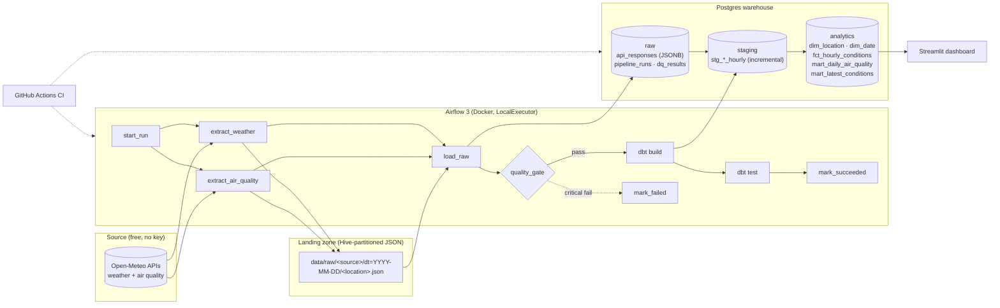
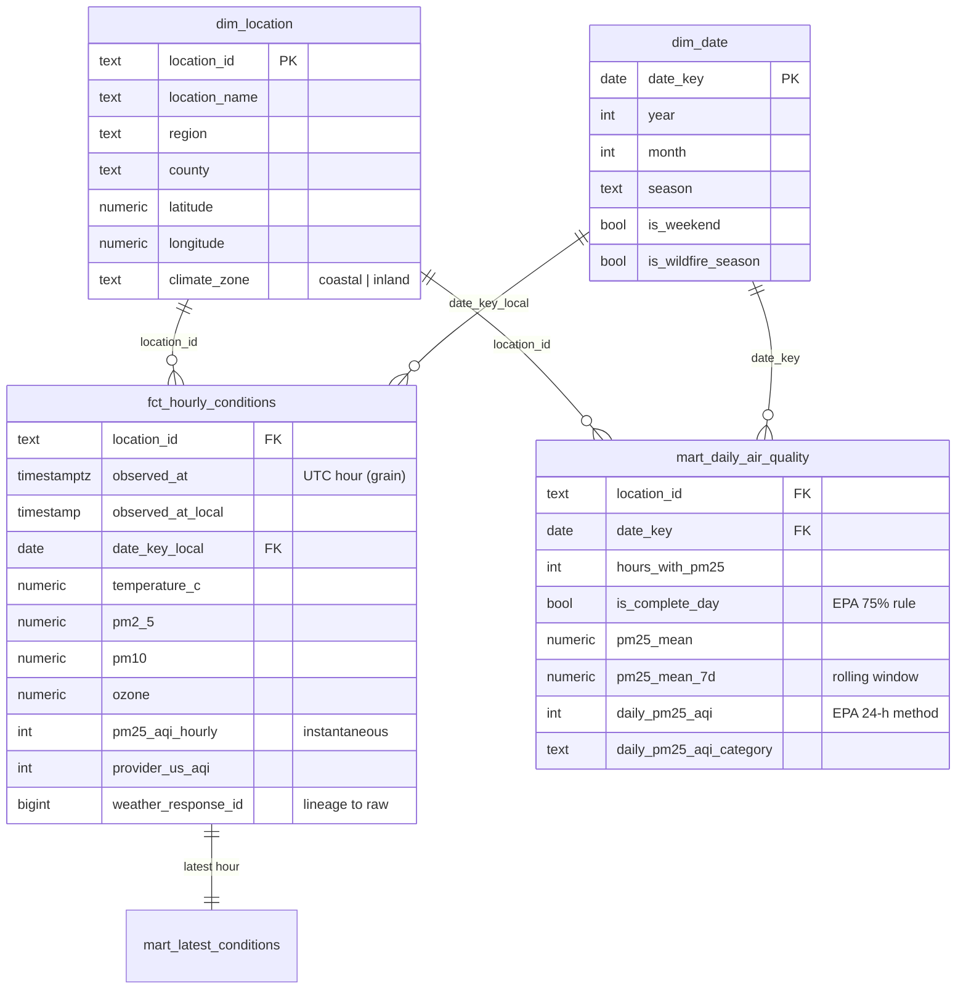

# LA Air Quality Data Platform

[](https://github.com/VanshC12/la-air-quality-pipeline/actions/workflows/ci.yml)


An end-to-end **ELT pipeline** that ingests hourly air-quality and weather data for ten
locations across the Los Angeles basin, lands it raw, loads it into a Postgres warehouse,
models it with dbt into a star schema with EPA Air Quality Index logic, validates it at
two layers, and serves it to a dashboard. Orchestrated by **Apache Airflow 3**, packaged
with **Docker Compose**, tested in **GitHub Actions**. Runs on a laptop with no cloud
account and no API key.

> **Status:** every component in this repo is exercised by CI on each push - unit tests,
> an integration test against a live Postgres, a full `dbt build` (schema, singular and
> unit tests), and a DAG integrity check under the pinned Airflow version.

<!-- Add after first run:     -->

---

## Architecture



**Flow of one daily run (06:00 UTC):**

1. `start_run` opens a row in `raw.pipeline_runs` and fixes the window: the previous *completed* UTC day.
2. `extract_weather` and `extract_air_quality` run in parallel, one API call per location, with exponential-backoff retries. Each response is written verbatim to the landing zone.
3. `load_raw` upserts the landed files into `raw.api_responses` (JSONB) on the natural key `(source, location, window)`, so re-runs replace rather than duplicate.
4. `quality_gate` runs seven SQL checks against the raw layer (coverage, row counts, window boundaries, null rate, plausibility, grid drift). Results persist to `raw.dq_results`; a critical failure stops the run **before dbt touches the marts** (write-audit-publish).
5. `dbt build` seeds the location list, flattens JSONB into typed hourly rows (incremental, high-watermark on `ingested_at`), and rebuilds the star schema.
6. `dbt test` runs 80 data tests + 2 unit tests; failing rows are stored in the `dq` schema for triage.

---

## What this project demonstrates

| Skill area | Where to look |
|---|---|
| **Pipeline design** - idempotent, re-runnable, backfillable units of work (one UTC day) | `src/la_aq/extract.py`, `load.py` (`ON CONFLICT ... DO UPDATE`), `dags/` |
| **Orchestration** - Airflow 3 Task SDK, parallel tasks, XCom, trigger rules, explicit timetable | `dags/la_air_quality_daily.py` |
| **ELT / warehousing** - raw JSONB → staging → marts; star schema; incremental models with `delete+insert` | `sql/init/`, `dbt/models/` |
| **SQL** - JSONB parallel-array flattening with `generate_series` + `LATERAL`, window functions, `percentile_cont`, timezone handling | `dbt/models/staging/*.sql`, `mart_daily_air_quality.sql` |
| **Data quality** - two layers: Python gate on raw + dbt schema/singular/unit tests + source freshness; failures persisted | `src/la_aq/quality.py`, `dbt/tests/`, `dbt/models/**/*.yml` |
| **Domain logic as code** - EPA 2024 PM2.5 AQI breakpoints as a dbt macro, unit-tested, cross-checked against the provider | `dbt/macros/aqi.sql`, `marts.yml` (`unit_tests`) |
| **Observability** - run ledger, DQ results table, freshness SLAs, dashboard health strip | `raw.pipeline_runs`, `raw.dq_results`, `dashboard/app.py` |
| **Reliability** - retries with backoff, atomic file writes, fail-closed gate, `mark_failed` path | `extract.py`, `quality.py`, DAG |
| **Software engineering** - typed Python package, CLI, pytest (unit + integration + DAG), ruff, CI, Docker | `pyproject.toml`, `tests/`, `.github/workflows/ci.yml` |
| **Config as data** - one CSV drives both the extractor and `dim_location` | `dbt/seeds/locations.csv`, `src/la_aq/locations.py` |

---

## Quickstart

Requirements: Docker Desktop (4 GB+ for Airflow), `make`. ~5 minutes.

```bash
git clone https://github.com/VanshC12/la-air-quality-pipeline.git
cd la-air-quality-pipeline
make up            # builds the image, starts warehouse + Airflow (first build ~3 min)
```

Open **http://localhost:8080** (user `airflow`, password `airflow`), find `la_air_quality_daily`,
and press ▶ *Trigger*. One run takes about a minute and processes yesterday (UTC).

Then:

```bash
make backfill START=2026-10-02 END=2026-10-08   # 7 more days via Airflow (dates = run dates)
make dashboard                                   # http://localhost:8501
make psql                                        # poke at the warehouse
```

```sql
select * from analytics.mart_daily_air_quality order by date_key desc, daily_pm25_aqi desc limit 20;
select * from raw.dq_results order by checked_at desc limit 20;
```

### Without Docker (or without internet)

```bash
pip install -e ".[dev]"
cp .env.example .env            # defaults point at localhost:5433
# start any Postgres 16 and set WAREHOUSE_DSN, then:
python -m la_aq run --synthetic --start 2026-10-13 --end 2026-10-19   # offline, deterministic data
cd dbt && dbt build --profiles-dir .
streamlit run ../dashboard/app.py
```

`--synthetic` generates responses with exactly the API's shape, so every downstream step is
identical. Drop the flag to hit the real Open-Meteo API.

---

## Repository layout

```
.
├── dags/
│   └── la_air_quality_daily.py     Airflow 3 DAG (Task SDK, CronTriggerTimetable)
├── src/la_aq/                      Ingestion package (pip-installable, CLI: python -m la_aq)
│   ├── config.py                   Settings from env vars
│   ├── locations.py                Reads the seed CSV (single source of truth)
│   ├── extract.py                  Open-Meteo client, retries, landing-zone writer
│   ├── load.py                     Postgres loader, run ledger, idempotent upsert
│   ├── quality.py                  Raw-layer quality gate (7 checks, persisted)
│   ├── synthetic.py                API-shaped synthetic data for tests / offline demos
│   └── cli.py                      extract | load | quality | run | synth | init-db
├── dbt/
│   ├── models/sources.yml          raw.* sources with freshness SLAs
│   ├── models/staging/             JSONB → typed hourly rows (incremental)
│   ├── models/intermediate/        Conformed hourly grain (view)
│   ├── models/marts/               dim_location, dim_date, fct_hourly_conditions,
│   │                               mart_daily_air_quality, mart_latest_conditions + unit tests
│   ├── macros/aqi.sql              EPA PM2.5 → AQI, category, UTC → local
│   ├── macros/tests/               Custom generic tests (accepted_range, unique_combination_of_columns)
│   ├── tests/                      Singular tests (future rows, completeness, provider cross-check)
│   ├── seeds/locations.csv         The ten monitoring locations
│   └── analyses/                   Ready-made analytical queries
├── sql/init/01_warehouse.sql       Raw schema DDL (run by Postgres on first start and by the CLI)
├── dashboard/app.py                Streamlit, reads only from analytics.*
├── tests/
│   ├── unit/                       Mocked HTTP, retries, landing, AQI reference, seed validation
│   ├── integration/                Loader idempotency + quality gate against a live Postgres
│   └── dags/                       DAG integrity under the pinned Airflow version
├── .github/workflows/ci.yml        lint → unit → (integration + dbt build) ∥ DAG integrity
├── docker-compose.yml              warehouse + airflow-db + Airflow 3 services + dashboard
├── Dockerfile                      apache/airflow:3.3.2 + dbt-postgres
└── Makefile                        up / down / trigger / backfill / dbt-* / test / lint
```

---

## Data model



**Layers**

| Schema | Owner | Contents | Materialisation |
|---|---|---|---|
| `raw` | Python | `api_responses` (verbatim JSONB), `pipeline_runs`, `dq_results` | DDL in `sql/init` |
| `staging` | dbt | `stg_open_meteo__weather_hourly`, `stg_open_meteo__air_quality_hourly` | incremental, `delete+insert` on `(location_id, observed_at)` |
| `analytics` | dbt | dims, fact, marts, `int_hourly_conditions` view | table / view |
| `dq` | dbt | one table per failed test (`store_failures`) | created on failure |

**Timezones.** Everything is requested and stored in UTC. The `to_local` macro converts once,
in `fct_hourly_conditions`, to `America/Los_Angeles` wall-clock time; daily marts group on
that local date. DST transitions therefore produce a 23- or 25-hour local day, which the
tests allow for explicitly.

**AQI.** `pm25_to_aqi` implements the EPA breakpoints in force since May 2024 (Good ends at
9.0 µg/m³, not 12.0). The daily mart applies it to the 24-hour mean, as the regulation does,
and withholds the value when fewer than 18 hours are present. The hourly "instantaneous" AQI
in the fact table is for trend lines only and is cross-checked against the provider's figure
by a warn-level test.

---

## Data quality strategy

Two layers, because they answer different questions:

| Layer | Question | Mechanism | On failure |
|---|---|---|---|
| **Raw gate** (`la_aq.quality`) | *Did we get what we asked for?* | 7 SQL checks on `raw.api_responses` for the run's window: location coverage, 24 rows per response, window boundaries, PM2.5 null rate, PM2.5 / temperature plausibility, API grid-snap drift | critical → task fails, dbt never runs; warn → logged + persisted |
| **Model tests** (dbt) | *Does the modelled data hold its invariants?* | 80 schema tests (`not_null`, `unique`, `relationships`, `accepted_values`, custom `accepted_range`, `unique_combination_of_columns`), 3 singular tests, 2 **unit tests** that pin the AQI arithmetic, source freshness SLAs (warn 36 h / error 72 h) | failing rows stored in `dq.*` |

Every gate result is written to `raw.dq_results` with the run id, so "how often does
PM2.5 completeness dip?" is a `GROUP BY`, not a log grep.

---

## Design decisions and trade-offs

- **Raw JSON kept verbatim, flattened in SQL (ELT) rather than in Python (ETL).** The warehouse
  can be rebuilt from `raw` without re-calling the API, schema changes upstream don't break
  the loader, and the transformation is version-controlled, tested and documented in dbt.
  Cost: the JSONB flatten is heavier than inserting typed rows - fine at this volume
  (10 locations × 24 h × 2 feeds ≈ 480 rows/day), and the incremental watermark keeps it O(new data).
- **One UTC day is the unit of work everywhere.** DAG data interval, CLI loop, landing partition and
  warehouse natural key all agree. Backfills and re-runs become boring, which is the point.
- **Explicit `CronTriggerTimetable(interval=1 day)`.** Airflow 3 changed the default: a bare cron
  string now yields a zero-length data interval at the trigger time. Being explicit means a run
  at 06:00 UTC on day D unambiguously processes day D-1, for scheduled, manual and backfill runs alike.
- **Two Postgres instances.** Airflow's metadata DB is write-heavy and should never contend with
  analytical queries; separating them also mirrors how this would be deployed for real.
- **Separate warehouse DDL for `raw`, owned by the ingestion code.** dbt should not own tables it
  doesn't write; the contract between the two is the `sources.yml` definition.
- **Quality gate before dbt, not only dbt tests after.** Catching a half-empty API response before
  the marts are rebuilt is cheaper and keeps the dashboard from ever showing a partial day as fact.
- **Synthetic data with the real API's shape.** CI is deterministic and offline; the same code path
  runs on real data with one flag removed.
- **No Celery/Redis, no cloud.** LocalExecutor is enough for one DAG and keeps the demo honest about
  its footprint. The "at scale" section below says what would change.

---

## Operations

| Task | Command |
|---|---|
| Trigger yesterday's run | `make trigger` |
| Backfill via Airflow | `make backfill START=2026-10-02 END=2026-10-08` (run dates; each processes the previous UTC day) |
| Backfill from the host (real API) | `make backfill-local START=2026-10-01 END=2026-10-07` |
| Re-run a day | trigger/backfill it again - upserts replace, incremental models pick up the new `ingested_at` |
| Add a location | add a row to `dbt/seeds/locations.csv`; next run extracts it and `dim_location` picks it up |
| Retire a location | set `is_active=false` in the seed (history is kept) |
| Check freshness | `make dbt-freshness` |
| Lineage docs | `make dbt-docs` → http://localhost:8081 |
| Rebuild everything from raw | `cd dbt && dbt run --full-refresh --profiles-dir .` |

See [`docs/RUNBOOK.md`](docs/RUNBOOK.md) for failure modes and how to diagnose them.

---

## Testing and CI

```bash
make lint              # ruff check + format
make test-unit         # 30 tests, no database, < 1 s
make test-integration  # loader idempotency + gate, needs WAREHOUSE_DSN
```

The GitHub Actions workflow runs three jobs on every push and PR:

1. **lint + unit** - ruff, pytest with coverage.
2. **integration** - Postgres 16 service → integration tests → 7 synthetic days → `dbt build`
   (seed, run, 80 data tests, 2 unit tests) → prove an incremental re-run is a no-op → re-load one
   day and prove the incremental models pick it up. dbt artifacts are uploaded for inspection.
3. **DAG integrity** - installs the pinned Airflow with the official constraints file and asserts the
   DAG parses, has the expected wiring, and resolves the previous UTC day for scheduled and manual runs.

---

## At scale: what would change

This runs on a laptop by design. The same shape maps directly onto a managed stack:

| Here | Production equivalent |
|---|---|
| `data/raw/<source>/dt=.../*.json` | S3 / GCS with the same Hive partitions; crawled by Athena / BigQuery external tables |
| Postgres warehouse | Snowflake / BigQuery / Redshift - `dbt-postgres` → `dbt-snowflake` etc.; the models need only dialect tweaks (`jsonb` → `VARIANT` / `JSON`) |
| Airflow in Compose | MWAA / Cloud Composer / Astronomer; same DAG file |
| `la_aq.quality` | Great Expectations or Soda checkpoints, or dbt source tests on an external table |
| `BashOperator` for dbt | Astronomer Cosmos (one Airflow task per dbt model) or dbt Cloud job trigger |
| Streamlit | Metabase / Looker on the same marts |
| `.env` | Secrets Manager / Secret Manager + Airflow connections |

Natural extensions: Slack alerting on `mark_failed`, SCD2 on `dim_location`, a streaming path
for the latest hour, partitioned fact table, and Terraform for the cloud variant.

---

## Data source

[Open-Meteo](https://open-meteo.com/) - free for non-commercial use, no API key, CC-BY 4.0.
Weather from the [Forecast API](https://open-meteo.com/en/docs); pollutants from the
[Air Quality API](https://open-meteo.com/en/docs/air-quality-api) (CAMS). AQI methodology:
US EPA *Technical Assistance Document for the Reporting of Daily Air Quality*, 2024 revision.

## License

MIT - see [LICENSE](LICENSE).
